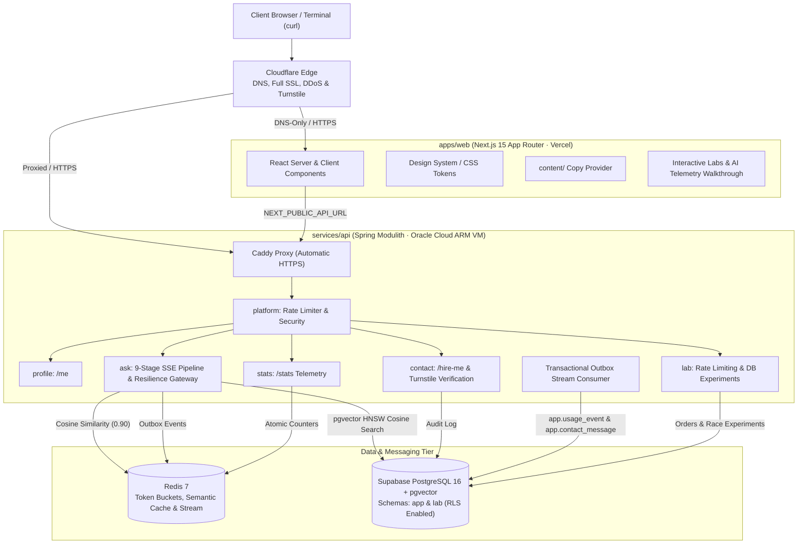

# priyanshu.dev

Personal portfolio, production systems showcase, and interactive distributed systems playground for **Priyanshu Sinha**, Backend Engineer (Java / Spring Boot).

* **Live Site**: [https://priyanshu.dev](https://priyanshu.dev)
* **Live API**: [https://api.priyanshu.dev](https://api.priyanshu.dev)
* **System Status**: [https://priyanshu.dev/status](https://priyanshu.dev/status)
* **Deployment Guide**: [infra/DEPLOY.md](infra/DEPLOY.md)

---

## 🏛 System Architecture

The codebase itself is an integral artifact of the portfolio, demonstrating clean architecture, strict typing, automated testing, containerized infrastructure, and separation of concerns.



---

## ⚡ Terminal Curl Examples against `api.priyanshu.dev`

You can interact with the live production backend directly from your terminal:

```bash
# 1. Developer Profile (compact terminal summary)
curl -s https://api.priyanshu.dev/me | jq .

# 2. Live System Stats
curl -s https://api.priyanshu.dev/stats | jq .

# 3. Interactive Ask Pipeline (Live Server-Sent Events stream)
curl -N -X POST https://api.priyanshu.dev/ask \
  -H "Content-Type: application/json" \
  -d '{"q":"How does he handle traffic spikes?"}'

# 4. Rate Limiting Lab (Token Bucket)
curl -i https://api.priyanshu.dev/lab/limited

# 5. Database Query Plan (EXPLAIN ANALYZE comparison)
curl -s -X POST https://api.priyanshu.dev/lab/db/explain \
  -H "Content-Type: application/json" \
  -d '{"strategy":"composite"}' | jq .

# 6. Submit a Contact / Hire Inquiry
curl -X POST https://api.priyanshu.dev/hire-me \
  -H "Content-Type: application/json" \
  -d '{
    "type": "client",
    "name": "Jane Developer",
    "email": "jane@example.com",
    "message": "Interested in building a high-throughput streaming backend.",
    "details": { "projectType": "Backend / APIs", "timeline": "1–3 months" }
  }'
```

---

## 📑 Architecture Decision Records (ADR Index)

Key architectural decisions are documented in detail under [`docs/adr/`](docs/adr/):

| ADR | Title | Summary |
|---|---|---|
| [0001](docs/adr/0001-monorepo-and-stack.md) | **Monorepo & Polyglot Stack** | Next.js 15 (React 19), Spring Boot 3.4 (Java 21), Postgres 16, and Redis 7 in a pnpm + Maven monorepo. |
| [0002](docs/adr/0002-modular-monolith.md) | **Modular Monolith & Hexagonal Architecture** | Spring Modulith module boundaries and Ports & Adapters isolating business domain logic. |
| [0003](docs/adr/0003-transactional-outbox.md) | **Transactional Outbox & Reliable Messaging** | Guaranteeing at-least-once message delivery from relational database transactions to Redis Streams without dual-write race conditions. |
| [0004](docs/adr/0004-lab-isolation.md) | **Lab Isolation, Fixed-Index Strategies & Ephemeral Wallets** | Isolated `lab` schema, pre-indexed tables without runtime DDL, ephemeral wallets, and strict statement timeouts. |
| [0005](docs/adr/0005-ask-pipeline-without-a-model.md) | **Ask Pipeline Without a Model** | Real 9-stage distributed pipeline telemetry with zero generative model cost, local 384-dim embeddings, and pluggable `AnswerProvider` port. |

---

## 📦 Monorepo Structure

```
priyanshu-dev/
├── apps/
│   └── web/                   # Next.js 15, App Router, TypeScript (strict)
│       ├── src/
│       │   ├── app/           # App routes: /, /ai, /lab/*, /connect, /journey, /status
│       │   ├── components/    # Reusable UI & typed state machine widgets
│       │   ├── hooks/         # useEventStream SSE consumer
│       │   └── styles/        # tokens.json and generated CSS design tokens
│       └── package.json
├── services/
│   └── api/                   # Spring Boot 3.4, Java 21, Spring Modulith
│       ├── src/main/java/     # Modules: platform, profile, contact, stats, lab, ask
│       ├── src/main/resources/db/migration/ # Flyway V1, V2, V3 migrations
│       ├── Dockerfile         # Multi-arch (amd64/arm64) production container
│       └── pom.xml            # Maven configuration
├── content/                   # Source of truth copy, labs, ask presets, and knowledge
├── infra/
│   ├── DEPLOY.md              # Numbered, zero-to-live production deployment checklist
│   ├── docker-compose.yml     # Local dev compose (Postgres 16 + pgvector, Redis 7)
│   └── production/            # Production Caddyfile and docker-compose.yml
├── docs/
│   ├── DATABASE.md            # Schema designs and Mermaid ERD
│   ├── PROJECT_BRIEF.md       # Product specifications and requirements
│   ├── github-settings.md     # Branch protection, 2FA, and Actions security rules
│   └── adr/                   # Architecture Decision Records (0001–0005)
├── .github/
│   ├── workflows/             # CI, multi-arch build, and automated deploy workflows
│   └── dependabot.yml         # Automated dependency vulnerability updates
├── README.md
└── LICENSE
```

---

## 🚀 Local Development Quickstart

### Prerequisites
* **Node.js**: v20+ or v22+
* **pnpm**: v9+ (or v12+)
* **Java**: OpenJDK 21 LTS
* **Docker / Docker Compose**: Docker 24+

### 1. Start Local Infrastructure (PostgreSQL 16 + Redis 7)
```bash
docker compose -f infra/docker-compose.yml up -d
```

### 2. Start Backend API
```bash
cd services/api
mvn spring-boot:run
```
The API boots on `http://localhost:8080`.

### 3. Start Frontend Web Application
```bash
pnpm --filter web dev
```
Open [http://localhost:3000](http://localhost:3000) in your browser.

### 4. Run Test Suites
```bash
# Frontend typecheck & vitest tests:
pnpm --filter web typecheck && pnpm --filter web test

# Backend architecture & integration tests:
cd services/api && mvn test
```

---

## 🚢 Production Deployment

For complete, step-by-step instructions on deploying the full stack to free-tier cloud infrastructure (Cloudflare, Supabase, Oracle Cloud Always Free VM, and Vercel), see:

👉 **[infra/DEPLOY.md](infra/DEPLOY.md)**

---

## 📄 License & Rights

* **Code**: Licensed under the [MIT License](LICENSE).
* **Content**: All text, narratives, case studies, and biographical details in `content/` and `design/` are **All Rights Reserved** © 2026 Priyanshu Sinha.
