# Database Architecture & Design — priyanshu.dev

## 1. Overview & Strategy

The persistent storage tier for `priyanshu.dev` uses PostgreSQL 16 with the `pgvector` extension.
- **Production**: Hosted on online Supabase (PostgreSQL 16 + pgvector), accessed solely via standard JDBC connections using credentials from environment variables (`DATABASE_URL` / `SUPABASE_DB_*`). No proprietary Supabase client libraries, triggers, or auth APIs are used in the backend.
- **Local Dev & Testing**: Containerized PostgreSQL with `pgvector/pgvector:pg16` managed via `infra/docker-compose.yml` and Testcontainers.
- **Migrations**: Single source of truth driven by Flyway (`services/api/src/main/resources/db/migration/`). Migrations run identically on both environments.
- **Schema Separation**: The `public` schema is **never used**. All objects are cleanly partitioned into two dedicated schemas:
  1. `app`: Core portfolio services, developer endpoints, contact messages, transactional outbox, semantic AI knowledge embeddings, and telemetry.
  2. `lab`: Isolated schema for interactive systems experiments (indexing strategies, N+1 query demonstrations, concurrency/pessimistic lock race conditions). Lab endpoints connect through an isolated role restricted strictly to `lab`.

---

## 2. Row Level Security (RLS) Policy

Every table in both `app` and `lab` schemas has Row Level Security explicitly enabled (`ALTER TABLE ... ENABLE ROW LEVEL SECURITY`).
- The backend application connects as the database owner role (`postgres`), which possesses table ownership and administrative rights.
- Any future untrusted, read-only, or third-party connections are locked down by default with deny-all policies unless explicit grants are supplied.

---

## 3. Mermaid Entity-Relationship Diagram

```mermaid
erDiagram
    %% APP SCHEMA
    "app.contact_message" {
        uuid id PK "default gen_random_uuid()"
        text type "recruiter | client | student"
        text name "Full name"
        text email "Contact email"
        text message "Body text"
        jsonb details "Type-specific metadata"
        text content_hash UK "SHA-256 deduplication"
        text ip_hash "SHA-256 hashed IP for rate limit"
        text status "default 'queued'"
        timestamptz created_at "default now()"
    }

    "app.outbox_event" {
        bigserial id PK
        text aggregate "Aggregate root name"
        text event_type "e.g. CONTACT_RECEIVED"
        jsonb payload "Event data"
        timestamptz created_at "default now()"
        timestamptz published_at "null until relayed"
    }

    "app.knowledge_chunk" {
        bigserial id PK
        text source "Markdown source file"
        text title "Chunk title"
        text content "Raw markdown text"
        text content_hash UK "Unique SHA-256"
        vector_384 embedding "384-dim embedding vector"
        timestamptz updated_at "default now()"
    }

    "app.ask_session" {
        text id PK "Client session token"
        int question_count "Questions asked count"
        timestamptz created_at "default now()"
        timestamptz last_seen_at "default now()"
    }

    "app.usage_event" {
        bigserial id PK
        text request_id UK "Idempotency key"
        text session_id "Session reference"
        int prompt_tokens "Tokens consumed"
        boolean cache_hit "Cache hit flag"
        int context_chunks "Retrieved chunks count"
        boolean blocked "Rate limit blocked flag"
        timestamptz created_at "default now()"
    }

    %% LAB SCHEMA
    "lab.orders_noidx" {
        bigserial id PK
        bigint user_id "No index"
        int amount_paise "Amount in INR paise"
        text status "PENDING, PAID, FAILED"
        timestamptz created_at "default now()"
    }

    "lab.orders_user_idx" {
        bigserial id PK
        bigint user_id "B-Tree index on user_id"
        int amount_paise "Amount in INR paise"
        text status "PENDING, PAID, FAILED"
        timestamptz created_at "default now()"
    }

    "lab.orders_composite_idx" {
        bigserial id PK
        bigint user_id "Composite index"
        int amount_paise "Amount in INR paise"
        text status "Composite index"
        timestamptz created_at "Composite index"
    }

    "lab.instructor" {
        bigserial id PK
        text name "Instructor name"
    }

    "lab.course" {
        bigserial id PK
        text title "Course title"
        bigint instructor_id FK "References instructor(id)"
    }

    "lab.wallet" {
        bigserial id PK
        bigint balance_paise "Balance in paise"
        bigint version "Optimistic lock version"
        timestamptz created_at "default now()"
    }

    "app.ask_session" ||--o{ "app.usage_event" : tracks
    "app.contact_message" ||--o| "app.outbox_event" : emits
    "lab.instructor" ||--o{ "lab.course" : teaches
```



---

## 4. Schema Specifications

### 4.1 Schema `app`

#### `app.contact_message`
Stores messages submitted from `/hire-me` or the web contact form.
* **`id`** (`uuid`, PK): Client or server-generated UUID.
* **`type`** (`text`): One of `'recruiter'`, `'client'`, `'student'`.
* **`name`** (`text`), **`email`** (`text`), **`message`** (`text`).
* **`details`** (`jsonb`): Adaptable JSON document containing segment-specific attributes:
  - Recruiter: `company`, `role`, `jobDescriptionUrl`
  - Client: `projectType`, `timeline`
  - Student: `stage`, `topic`
* **`content_hash`** (`text`, UNIQUE): `SHA-256(type || ':' || email || ':' || message)` prevents duplicate spam.
* **`ip_hash`** (`text`): Anonymized IP hash used for audit and IP-level limits.
* **`status`** (`text`): Initial status `'queued'`, transitioning to `'notified'`, `'failed'`.
* **`created_at`** (`timestamptz`): Insertion timestamp.

#### `app.outbox_event`
Transactional Outbox table ensuring at-least-once asynchronous event delivery.
* **`id`** (`bigserial`, PK): Sequence ID.
* **`aggregate`** (`text`): Aggregate name (e.g. `'contact'`, `'ask'`).
* **`event_type`** (`text`): Event type (e.g. `'CONTACT_RECEIVED'`).
* **`payload`** (`jsonb`): Event payload.
* **`created_at`** (`timestamptz`): Event creation timestamp.
* **`published_at`** (`timestamptz`, NULLABLE): Set when the outbox relay publishes to Redis Stream.

#### `app.knowledge_chunk`
Vector database storage for AI semantic retrieval.
* **`id`** (`bigserial`, PK): Sequence ID.
* **`source`** (`text`), **`title`** (`text`), **`content`** (`text`).
* **`content_hash`** (`text`, UNIQUE): Deterministic hash for upsert deduplication.
* **`embedding`** (`vector(384)`): 384-dimensional dense vector embeddings.
* **Index**: HNSW index using cosine similarity:
  ```sql
  CREATE INDEX IF NOT EXISTS knowledge_chunk_embedding_hnsw_idx 
  ON app.knowledge_chunk USING hnsw (embedding vector_cosine_ops);
  ```

#### `app.ask_session` & `app.usage_event`
Tracks telemetry and API query quotas without logging private prompt content.
* `usage_event.request_id` enforces idempotency for asynchronous usage event ingestion.

---

### 4.2 Schema `lab`

#### `lab.orders_noidx`, `lab.orders_user_idx`, `lab.orders_composite_idx`
Three structurally identical tables containing e-commerce orders for query optimization and `EXPLAIN ANALYZE` demonstrations:
* `orders_noidx`: Only PK. Forces a sequential scan (`Seq Scan`).
* `orders_user_idx`: Single B-Tree index on `user_id`. Shows dramatic reduction in execution time for filtering by customer.
* `orders_composite_idx`: Composite index on `(user_id, created_at, status)`. Demonstrates index-only scans and elimination of sort steps.

#### `lab.instructor` & `lab.course`
Demonstrates the classic N+1 query problem and its resolution via eager fetching / `JOIN FETCH`.

#### `lab.wallet`
Demonstrates concurrency control, race conditions (double spending), and optimistic vs. pessimistic locking (`SELECT ... FOR UPDATE`).

---

## 5. Seed Strategy

To ensure zero database bloat and stay comfortably inside free-tier resource limits:
- Seed job default: `200,000` rows per orders table (total ~600,000 rows across the three tables).
- Seed execution is controlled via Spring Boot property:
  ```yaml
  priyanshu:
    lab:
      seed:
        enabled: false
        orders-count: 200000
  ```
