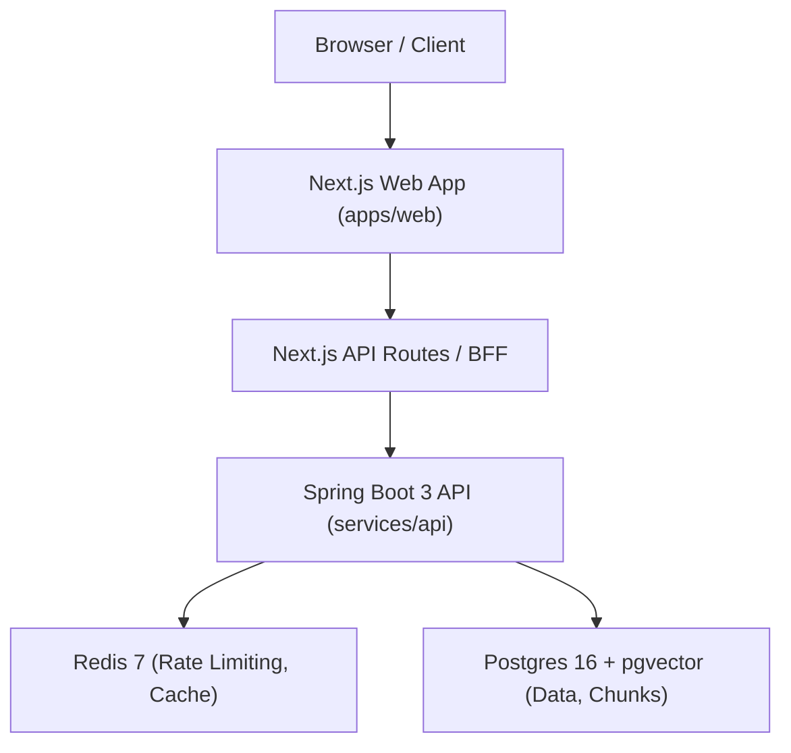

# PROJECT_BRIEF — priyanshu.dev

## 1. Executive Summary & Vision

`priyanshu.dev` is the personal portfolio and interactive technical playground for Priyanshu Sinha, an SDE-1 Backend Engineer at StudyIQ. Because Priyanshu is a backend engineer specializing in distributed systems, high throughput, and AI system design, the repository itself is an artifact of the portfolio. Code quality, architecture, documentation, and mechanical sympathy matter as much as user-facing features.

The site is designed to immediately establish credibility with three primary audiences:
1. **Engineering Leaders & Recruiters**: Proving deep systems knowledge through live production-grade demonstrations (not mock fluff), concrete scale metrics (20+ microservices, 100K+ req/min peaks, 92%+ cache hits), and architectural rigor.
2. **Founders & Freelance Clients**: Demonstrating full-cycle capability across web, mobile, robust backends, and AI engineering.
3. **Engineers & Students**: Engaging peer-to-peer with candid technical writeups, interactive lab simulations, and personal journey stories.

---

## 2. Core Non-Negotiable Rules

1. **Content Separation**: No user-facing text, copy, or labels may be hardcoded into UI components. All copy lives strictly in `content/` (structured JSON, markdown, or TypeScript dictionaries). Components only consume content via structured interfaces.
2. **AI Page Answer Constraint**: Under **no circumstances** is an actual AI answer text ever generated or displayed on the AI architecture walkthrough page (`/ai`). The purpose of the AI page is to demystify backend architecture—rate limiting, semantic caching, vector retrieval, token budgeting, orchestration, and streaming—without running expensive or irrelevant LLM generation. The UI explicitly states: *"Nothing is answered — you'll see how it flows."*
3. **Database Operations Policy**: Per workspace safety constraints, automated database operations or unmonitored scripts against live databases are strictly prohibited. The developer/user executes DB operations directly.
4. **Theme Architecture**: Themes must switch cleanly via the HTML `data-theme` attribute (`"light"` vs `"dark"`), driven by centralized CSS variables generated from tokens.

---

## 3. Themes, Typography & Design Tokens

### Themes & Color Palettes
The site supports two primary themes, plus an editorial warm variation for the Journey page:

#### 1. Light Theme — "Ink & Blue"
* Clean, authoritative, editorial ink aesthetic.
* **Background (`bg`)**: `#FBFBFA`
* **Surface (`surface`)**: `#FFFFFF`
* **Tint / Sub-surface (`tint`)**: `#F4F4F2`
* **Primary Text (`text`)**: `#111418`
* **Body Text (`body`)**: `#3A3F47`
* **Muted / Secondary Text (`muted`)**: `#4A5059`
* **Borders (`border`, `border2`)**: `#E6E6E3`, `#D4D4D0` (or `#E3E3DF`)
* **Primary Accent (`accent`)**: `#1F4FD1` (Electric Blue)
* **Button Background / Text**: `#111418` / `#FFFFFF`
* **Status Success / Active (`green`, `dot`, `ok`)**: `#0F6B52`
* **Status Warning / Blocked (`blocked`)**: `#B4400E`
* **Terminal Background (`term`)**: `#111418`
* **Active Stage Background (`activeBg`)**: `#EEF2FD`
* **Done Stage Background (`doneBg`)**: `#EEF6F2`

#### 2. Dark Theme — "Midnight"
* Sleek, high-contrast, deeply focused dark mode.
* **Background (`bg`)**: `#0B0D10`
* **Surface (`surface`)**: `#14171C`
* **Tint / Sub-surface (`tint`)**: `#101318`
* **Primary Text (`text`)**: `#E8EAED`
* **Body Text (`body`)**: `#C9CDD3`
* **Muted / Secondary Text (`muted`)**: `#A3A9B3`
* **Borders (`border`, `border2`)**: `#262B33`, `#3A404A`
* **Primary Accent (`accent`)**: `#7AA2FF` (Vibrant Sky Blue)
* **Button Background / Text**: `#E8EAED` / `#0B0D10`
* **Status Success / Active (`green`, `dot`, `ok`)**: `#5FD39B`
* **Status Warning / Blocked (`blocked`)**: `#FF9A7A`
* **Terminal Background (`term`)**: `#05070A`
* **Active Stage Background (`activeBg`)**: `#18213A`
* **Done Stage Background (`doneBg`)**: `#12261D`

#### 3. Journey Theme — "Warm Memoir"
* Applied to the Journey narrative chapters. Always rendered in warm paper tones.
* **Background**: `#F6F1E9`
* **Text**: `#2A2420`
* **Border**: `#E2D9CB`
* **Muted**: `#6B5F55` / `#5A4F46`
* **Accent**: `#8A3B1F`
* **Chapter Accents**: Individual chapter palette shifts (Muted Slate `#E8EEF2`, Amber `#F3E6C8`, Sage `#DDEBDF`, Deep Charcoal `#2F2A33`, Indigo `#E3E7F3`).

### Typography
* **UI & Body**: `IBM Plex Sans`, `-apple-system`, `BlinkMacSystemFont`, `sans-serif` (weights: 400, 500, 600)
* **Code & Telemetry**: `IBM Plex Mono`, `ui-monospace`, `Menlo`, `monospace` (weights: 400, 500)
* **Journey Editorial**: `Newsreader`, `Georgia`, `serif` (weights: 400, 500, italic)

---

## 4. Page-by-Page Specifications & Interactive Widgets

### 4.1 Home (`/` — `Main.dc.html`)
* **Header / Nav**: Site logo `priyanshu.dev`, theme toggle button (Sun/Moon SVG icon), links: `Lab`, `AI`, `Journey`, and CTA button `Let’s talk`.
* **Hero Section**:
  * Mono badge: `"Hi, I'm"`
  * Title: `"Priyanshu Sinha."`
  * Subheading: *"I build the backends that keep products fast — and the AI that runs on top of them."*
  * Bio paragraph: Backend engineer at StudyIQ (20+ microservices, 100K+ req/min peaks).
  * Quick-facts bar: NOW (`SDE-1 Backend · StudyIQ`), BASED IN (`Gurugram, India`), FOCUS (`Distributed systems + AI`), OPEN TO (`● Freelance projects`).
  * CTAs: `"See my backend in action ↓"`, `"Work with me"`, GitHub, LinkedIn, Résumé.
* **Interactive Widget — Live Request Journey (`#demo`)**:
  * **Demonstration**: Visualizes a request traversing a modern AI backend pipeline step-by-step.
  * **State & Metrics**: Tracks total requests, cache hits, and remaining tokens (`remaining/5`).
  * **Controls**:
    * Speed switch: Toggle between `"Playback: slow-mo"` (default, slowed down for comprehension) and `"Playback: real speed"`.
    * Question selector pills: 3 pre-configured questions (`"What does Priyanshu work on?"`, `"How does he handle traffic spikes?"`, `"Has he built AI systems?"`).
    * Action button: `"Send request →"` (shows `"Sending..."` while executing).
  * **Pipeline Stages (6 interactive boxes)**:
    1. `01 API gateway` (`auth + routing` · 2 ms)
    2. `02 Rate limiter` (`Redis token bucket` · 1 ms)
    3. `03 Cache` (`Redis lookup` · 1 ms)
    4. `04 Retriever` (`vector search, top-3` · 38 ms)
    5. `05 LLM` (`generate answer` · 840 ms)
    6. `06 Stream` (`SSE to browser` · streamed)
  * **Visual Execution**:
    * Progress track with an animated indicator dot travelling across stages.
    * Stage cards change styles based on status: `waiting`, `active` (accent highlight), `done` (green), `skipped` (dashed border for cache hits), or `blocked` (red for 429).
    * Terminal display: Shows HTTP status (`200 OK` or `429 Too Many Requests`), headers (`X-Cache: HIT/MISS`, `X-RateLimit-Remaining: N`, `X-Response-Time`), and streamed response text.
    * Token bucket refills automatically over time (refill interval: 3s).
* **Terminal Curl Section ("For developers")**:
  * Mock terminal showing `curl priyanshu.dev/api/me` returning JSON with name, role, stack, openTo, and `POST /api/hire-me`.
* **Section Index Cards**:
  * Highlights `01 / The Lab`, `02 / AI`, `03 / Journey`.
* **Inside the Lab List**:
  * Lists upcoming and live lab experiments (Rate limiting `LIVE`, Databases `LIVE`, Caching `SOON`, Flash sale `SOON`, Idempotent payments `SOON`, Circuit breaker `SOON`, Queues & DLQ `SOON`).
* **About & Footer**:
  * Summary, résumé download link, work with me links, and live telemetry counter placeholder (`served today`, `cache hits`, `rate limits triggered`).

---

### 4.2 Lab 01: Rate Limiting (`/lab/rate-limiting` — `RateLimiter.dc.html`)
* **Header & Experiment Sub-Nav**: Lab experiments sub-bar linking `01 Rate limiting` (active), `02 Databases`, `03 Caching · soon`, `04 Flash sale · soon`.
* **Intro Header**: *"How do you stop one user from taking down your API?"* Explains token bucket mechanics in under a millisecond.
* **Interactive Widget — Live Token Bucket Demo**:
  * **Demonstration**: Visual token capacity and burst rejection under concurrent load.
  * **Visual Bucket**: 5 visual slot boxes that fill/drain dynamically (capacity 5, refills 1 token every 2s).
  * **Actions**:
    * `"Send 1 request"`: Drains 1 token, logs `200 OK` (or `429` if empty).
    * `"Burst 10"`: Instantly fires 10 requests, exhausting available tokens and triggering `429 Too Many Requests` with `Retry-After: 2`.
    * `"Reset"`: Restores bucket to capacity 5 and clears log.
  * **Telemetry Counter**: Live count of `200 OK` vs `429 Too Many`.
  * **Network Inspection Log**: Terminal displaying request history in reverse-chronological order with status, color, and `X-RateLimit-Remaining` header.
* **Architecture Diagram**:
  * Flow diagram: `Client (browser)` → `Rate-limit filter (Spring OncePerRequestFilter)` ⇄ `Redis (Lua script, atomic)` → `Controller (only if allowed)`.
  * Callout: `bucket empty → 429 + Retry-After, controller never runs`.
* **Source Code Inspection**:
  * Displays atomic `token_bucket.lua` script executed inside Redis (`KEYS[1]`, `HGET`, `HSET`, `math.min`, etc.).
* **Trade-Off Analysis**:
  * Comparison between Token Bucket, Sliding Window, and Lua Atomic Execution.

---

### 4.3 Lab 02: Databases (`/lab/databases` — `Database.dc.html`)
* **Intro Header**: *"Most 'slow APIs' are really slow queries."* 3 production case studies tested against realistic data.
* **Experiment 01 Widget — Indexes & Query Plans**:
  * Scenario: *"Show me a user's last 20 orders"* (`SELECT * FROM orders WHERE user_id = 4821 AND created_at > now() - interval '30 days' ORDER BY created_at DESC LIMIT 20;`).
  * Strategies (pills):
    1. `No index`: 1,000,000 rows scanned, ~418 ms, Seq Scan with Sort.
    2. `Index on user_id`: 1,180 rows scanned, ~6 ms, Index Scan with Sort filter.
    3. `Composite (user_id, created_at)`: 20 rows scanned, ~0.1 ms, Index Scan backward (no sort needed, stops at limit).
  * Widget displays rows scanned, execution time, log-scale work done bar, and full PostgreSQL `EXPLAIN ANALYZE` output.
* **Experiment 02 Widget — The N+1 Problem**:
  * Scenario: `GET /api/courses` (50 courses, each with its instructor).
  * Strategies:
    1. `Lazy loading (naive)`: Fires 1 query for courses + 50 individual queries for instructors (51 queries total, high latency).
    2. `JOIN FETCH`: Single query `SELECT c.*, i.* FROM courses c JOIN instructors i ON i.id = c.instructor_id` (1 query total).
  * Live animation of queries executing into a SQL log terminal with `X-Query-Count`.
* **Experiment 03 Widget — Transactions & Race Conditions**:
  * Scenario: Two simultaneous ₹700 withdrawals hit a ₹1,000 balance wallet.
  * Strategies:
    1. `Read, then write (no lock)`: Thread 1 and Thread 2 both read ₹1,000 balance, both deduct ₹700; final balance ₹300, lost update paying out ₹1,400 from a ₹1,000 wallet (bug!).
    2. `SELECT … FOR UPDATE`: Pessimistic write lock (`@Lock(PESSIMISTIC_WRITE)`). T1 locks row; T2 blocks until T1 commits; T2 reads updated balance ₹300, check fails, rolls back with `409 Insufficient funds`.
    3. `Optimistic (version column)`: `@Version` column. T1 succeeds with `version=7`; T2 update matches 0 rows (stale version), retries, reads ₹300, safely rejects with 409.
  * Visual timeline log showing T1 vs T2 step interleaving, final balance, and transaction code snippets.

---

### 4.4 AI Architecture Walkthrough (`/ai` — `AI.dc.html`)
* **Intro Header**: *"In every AI product, the backend is the real hero."*
* **Interactive Client App & Walkthrough**:
  * **Input box**: Type any question (e.g., *"What does he do at StudyIQ?"*, *"How does he use Redis?"*, *"Who won the cricket match yesterday?"*).
  * **Rule Reminder**: Submitting a question runs client-side analysis and simulates backend traversal; **it never outputs an answer text**.
* **16-Box Architecture Diagram (Sticky Left Column)**:
  * Organized in 4 functional rows:
    1. **Request Path**: `Client`, `API gateway`, `Rate limiter`, `Semantic cache`, `Orchestrator`, `Postgres`, `Vector DB`, `LLM gateway`, `Model`, `Stream (SSE)`.
    2. **Async / After Response**: `Kafka queue`, `Usage & cost`, `Feedback & evals`.
    3. **Ingestion / Offline**: `New docs`, `Embed workers`, `Vector DB upsert`.
  * Highlighted boxes illuminate with accents based on the currently selected step.
* **9-Step Walkthrough (Scrollable Right Column / Next-Prev Stepper)**:
  1. *A question arrives*: Auth + Redis token budget check (429 if empty).
  2. *Check the semantic cache*: 256-dim embedding cosine similarity against query cache (HIT if similarity >= 0.90, bypasses model).
  3. *Orchestrate the request*: Session load from Postgres, tool registry resolution.
  4. *Retrieve only what matters*: pgvector top-k retrieval with similarity scores.
  5. *Call the model — safely*: Resilience4j timeouts, exponential backoff, circuit breakers, fallback routing.
  6. *Stream it back*: Server-Sent Events (SSE) with backpressure.
  7. *Do the bookkeeping later*: Async Kafka events for token usage, billing, and evaluation.
  8. *Keep knowledge fresh*: Idempotent background embedding ingestion via content hashing.
  9. *Now count the boxes*: 16 boxes total, only 1 is the LLM—the rest is distributed backend engineering.
* **Voice Agent Pipeline Section**:
  * Three-stage streaming: `Listen (ASR)` → `Think (LLM)` → `Speak (TTS)` + `Escape Hatch (Human handoff)`.
* **Concept Badges**:
  * Embeddings, Semantic caching, Token budgets, Retries & fallbacks, Streaming SSE, Structured outputs, Tool calling, ASR/TTS, Evals & guardrails.

---

### 4.5 Let’s Talk / Contact (`/hire` — `Hire.dc.html`)
* **Audience Paths**:
  1. `Recruiters & hiring managers`: "We're hiring" → 30-second snapshot.
  2. `Clients & founders`: "We need something built" → Services breakdown.
  3. `Students & developers`: "Just saying hi" → Informal networking.
* **Recruiter Snapshot Details**:
  * Current role: SDE-1 Backend · StudyIQ (Gurugram).
  * Experience: 1.5+ years production backend.
  * Core stack: Java, Spring Boot, Kafka, Redis, AWS.
  * Metrics: 20+ microservices owned, 100K+ req/min observed peaks, 92%+ cache hit rate.
  * Download Résumé CTA, Email CTA, LinkedIn CTA.
* **Client Services Breakdown**:
  * 6 Service cards: Full product builds (React + Flutter + Spring Boot), Backend & APIs, AI features, Performance rescue, Database design, Deployment & DevOps.
  * 4-Stage Process: Discovery call → Plan & quote → Build in sprints → Launch & handover.
  * NDA Client Case Study cards.
* **Adaptive Contact Form**:
  * Segmented selector: `Recruiter` | `Client` | `Student / developer`.
  * Dynamic form fields:
    * Recruiter: Name, Work email, Company, Role / Job link, Message, *"Send to Priyanshu"*.
    * Client: Name, Email, Project type dropdown, Timeline dropdown, Project description, *"Request a quote"*.
    * Student: Name, Email, Stage dropdown (Student, Fresher, Developer), Topic dropdown, Message, *"Say hi"*.
  * Submission state: Displays `202 Accepted · queued for delivery` confirmation card.

---

### 4.6 Journey (`/journey` — `Journey.dc.html`)
* **Editorial Layout**: Warm aesthetic (`#F6F1E9`), elegant `Newsreader` typography, personal essay tone.
* **6 Chapters**:
  * *Chapter 01: Where it began* (Hometown, curiosity about computing).
  * *Chapter 02: Four years, one scholarship, a lot of late nights* (Chandigarh University 2021–2025, 8.02 CGPA, 50% scholarship, first real programs).
  * *Chapter 03: A new city, and real code for real people* (Ahmedabad 2025, Meditab Software healthcare internship, Node.js/PostgreSQL/RabbitMQ, first production bugs).
  * *Chapter 04: The chapter that tested me* (Resilience through adversity, lessons learned).
  * *Chapter 05: The first real job* (StudyIQ in Gurugram, high-scale Java microservices, on-call ownership).
  * *Chapter 06: Still being written* (Invitation to connect).

---

## 5. Architecture & Implementation Blueprint



### Repository Structure
```
priyanshu-dev/
├── apps/
│   └── web/                   # Next.js 15, App Router, TypeScript (strict)
│       ├── src/
│       │   ├── app/           # App Router pages and layouts
│       │   ├── components/    # Reusable UI components (consume content/)
│       │   └── styles/
│       │       ├── tokens.json# Centralized design tokens
│       │       └── tokens.css # Generated CSS custom properties
│       ├── tsconfig.json
│       └── package.json
├── services/
│   └── api/                   # Spring Boot 3, Java 21, Gradle Kotlin DSL
│       ├── src/main/kotlin/   # (or java/)
│       ├── src/main/resources/
│       │   └── application.yml
│       ├── build.gradle.kts
│       └── settings.gradle.kts
├── content/                   # All text copy lives here (JSON/TS/MD)
├── infra/
│   └── docker-compose.yml     # Postgres 16 (pgvector) + Redis 7
├── docs/
│   ├── PROJECT_BRIEF.md       # This document
│   └── adr/
│       └── 0001-monorepo-and-stack.md
├── design/                    # Untouched HTML reference prototypes
├── .github/
│   └── workflows/
│       └── ci.yml             # Lint, test, build CI workflow
├── .editorconfig
├── .gitignore
├── .env.example
├── README.md
└── LICENSE
```

### Engineering Standards
* **TypeScript Strictness**: `strict: true`, no implicit `any`, strict null checks.
* **Spring Boot Standards**: Clean layered architecture (Controller, Service, Repository), Actuator health probes (`/actuator/health`).
* **Content Immutability**: Code contains zero hardcoded copywriting. Changing copy requires zero JSX/TSX alterations.
